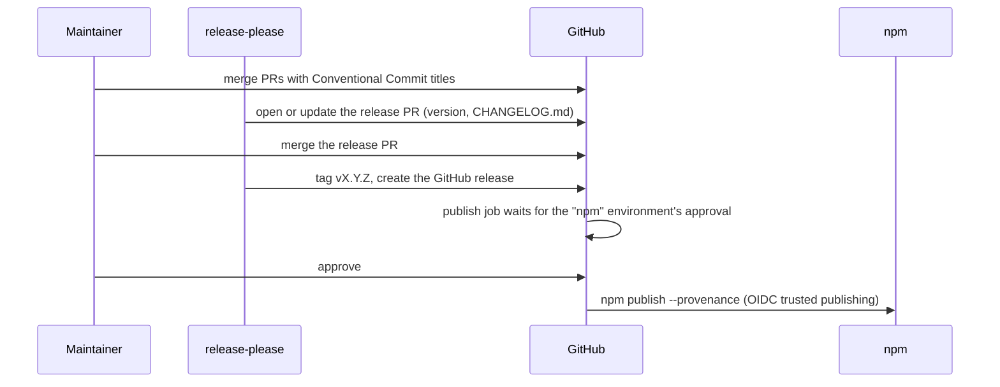

# Repository design

This page designs the open-source repository of `agent-evals`: what it is called, how it is licensed, built, tested, released and governed, and how it leaves the monorepo it was written in. It is the plan the extraction follows, and afterwards the reference for maintainers.

## Status

|                   |                                                                         |
| ----------------- | ----------------------------------------------------------------------- |
| Repository        | `github.com/DavidKloster/agent-evals`, **private** until the owner's go |
| npm package       | `@agent-evals/core`, **not published** until the owner's go             |
| Licence           | Apache-2.0                                                              |
| Copyright holder  | David Kloster                                                           |
| Version at launch | 0.1.0                                                                   |

## Decisions

The owner fixed the first block. The maintainer decided the rest, each with a recommendation that the owner may revisit.

| #   | Topic                             | Decision                                                                                                                                                                                                                                                                                                                                                                                                                                                                                                                 | Why                                                                                                                                                                                                                                      | Decided by             |
| --- | --------------------------------- | ------------------------------------------------------------------------------------------------------------------------------------------------------------------------------------------------------------------------------------------------------------------------------------------------------------------------------------------------------------------------------------------------------------------------------------------------------------------------------------------------------------------------ | ---------------------------------------------------------------------------------------------------------------------------------------------------------------------------------------------------------------------------------------- | ---------------------- |
| D1  | Licence                           | Apache-2.0, with `LICENSE` (the canonical text) and `NOTICE`                                                                                                                                                                                                                                                                                                                                                                                                                                                             | Permissive, with an explicit patent grant                                                                                                                                                                                                | Owner                  |
| D2  | Home                              | `github.com/DavidKloster/agent-evals`, the owner's personal account                                                                                                                                                                                                                                                                                                                                                                                                                                                      | The owner's choice                                                                                                                                                                                                                       | Owner                  |
| D3  | npm name                          | `@agent-evals/core` in a new npm organization `agent-evals`; adapter packages, when they come, are `@agent-evals/<adapter>`                                                                                                                                                                                                                                                                                                                                                                                              | An organization scope groups the core and its adapters under one name nobody else can take, independent of a personal account                                                                                                            | Owner                  |
| D4  | Copyright                         | "Copyright 2026 David Kloster" in `NOTICE`                                                                                                                                                                                                                                                                                                                                                                                                                                                                               | The owner wrote it                                                                                                                                                                                                                       | Owner                  |
| D5  | Visibility                        | Private until the owner's go; the first real npm publish only on the owner's go                                                                                                                                                                                                                                                                                                                                                                                                                                          | Both are outward-facing and hard to undo                                                                                                                                                                                                 | Owner                  |
| D6  | Naming and credit                 | No "Anthropic" or "Claude" in the name; the README credits Anthropic's article "Demystifying evals for AI agents" as the method, with a trademark note and no claim of endorsement                                                                                                                                                                                                                                                                                                                                       | Trademarks, honesty                                                                                                                                                                                                                      | Owner                  |
| D7  | Contributions                     | **Developer Certificate of Origin** (`Signed-off-by:` on every commit, checked in CI), no CLA                                                                                                                                                                                                                                                                                                                                                                                                                            | No CLA service, no friction for a first contributor; Apache-2.0's inbound = outbound covers the licence of contributions. The cost: relicensing later needs every contributor's consent                                                  | Owner (as recommended) |
| D8  | Release automation                | **release-please**: Conventional Commits on `main` → a release PR with the version and `CHANGELOG.md` → merging it tags `vX.Y.Z` and creates the GitHub release → the same workflow publishes to npm                                                                                                                                                                                                                                                                                                                     | The repository already uses Conventional Commits; one maintainer, so no per-PR changeset files to remember. Changesets is the alternative if outside contributors want to word release notes themselves                                  | Maintainer             |
| D9  | Dependency updates                | **Dependabot** (npm and GitHub Actions, weekly, grouped, a 14-day cooldown)                                                                                                                                                                                                                                                                                                                                                                                                                                              | Built in, no app to install, enough for two runtime dependencies                                                                                                                                                                         | Maintainer             |
| D10 | Package manager of the repository | **npm** with `package-lock.json`                                                                                                                                                                                                                                                                                                                                                                                                                                                                                         | One package; contributors need nothing beyond Node                                                                                                                                                                                       | Maintainer             |
| D11 | Packages                          | **One package** (`@agent-evals/core`) now. An adapter that needs a heavy dependency (a browser, a provider SDK) becomes its own package `@agent-evals/<adapter>` with the core as a peer dependency, **in the same repository**: it then becomes an npm workspaces monorepo (`packages/core`, `packages/<adapter>`), and release-please's manifest mode versions and releases each package on its own                                                                                                                    | The built-in adapters use `fetch` only, so splitting now adds release work and no value; one repository keeps the core and its adapters tested together                                                                                  | Maintainer             |
| D12 | Runtime                           | **Node ≥ 22.18** (`engines`); CI tests 22.18.0 (the floor) and the latest 22 and 24 on Linux, and on macOS and Windows once the repository is public; ESM only. Node 26 joins the matrix when it becomes LTS, and 22 leaves when it reaches its end of life (April 2027)                                                                                                                                                                                                                                                 | 22.18 is the first 22.x that strips types by default, which the repository's own scripts and tests use; 24 is the active LTS line, 22 in maintenance                                                                                     | Maintainer             |
| D13 | Build                             | `tsc` emits ESM and declarations to `dist/` (`tsconfig.build.json`, with `rewriteRelativeImportExtensions`); `exports` and the `agent-evals` bin point at `dist/`                                                                                                                                                                                                                                                                                                                                                        | Node refuses type stripping under `node_modules` (`ERR_UNSUPPORTED_NODE_MODULES_TYPE_STRIPPING`), so the published package must be JavaScript. Verified: the build of today's `src/` runs from a `node_modules` install, library and CLI | Maintainer             |
| D14 | Versioning and API promise        | Semver, **0.x** until the API has outside users: in 0.x a **minor** release may break the public API (named in its changelog), a **patch** never does. Deprecated exports warn for at least one minor release before they go. 1.0 when two minor releases in a row needed no breaking change. Published for users in [Stability and versioning](../stability.md)                                                                                                                                                         | Honest about an API that is weeks old, yet predictable                                                                                                                                                                                   | Maintainer             |
| D15 | Public API                        | The exports of the package root, the CLI (commands, options, exit codes), and the file formats: task and suite files (with their JSON Schemas), transcript JSONL, `run.json`, the labels and reviews files. Everything else (deep imports, the viewer's HTTP API, the report HTML's markup) is internal                                                                                                                                                                                                                  | A clear line for D14                                                                                                                                                                                                                     | Maintainer             |
| D16 | Format versions                   | `run.json` and every transcript line carry `formatVersion` (`FORMAT_VERSION`, starting at 1). `readRun` refuses a newer one and reads a file without one (written before 0.1.0) as 1; `writeReports` writes the version a run carries. The version goes up only with a change an older reader would misread, and that release converts older files in `readRun`                                                                                                                                                          | Files outlive the code that wrote them                                                                                                                                                                                                   | Maintainer             |
| D17 | Docs                              | **Markdown in `docs/`** rendered by GitHub, linked from the README. A docs site (VitePress or Starlight on GitHub Pages) when the docs outgrow that or at 1.0                                                                                                                                                                                                                                                                                                                                                            | Nothing to host or build until it pays                                                                                                                                                                                                   | Maintainer             |
| D18 | Schemas for editors               | The JSON Schemas ship in the npm package (`schema/`); editors use `https://unpkg.com/@agent-evals/core@0.1/schema/task.schema.json` (and `suite.schema.json`), pinned per minor because a 0.x minor may change the format. A SchemaStore entry for `*.eval.yaml` once the format is stable. The examples keep relative `$schema` paths, so they validate against the schema of the same commit; the task template (`templates/`), which users copy out of the package, moves to the published URL with the first publish | No server to run                                                                                                                                                                                                                         | Maintainer             |
| D19 | Security reporting                | GitHub **private vulnerability reporting** only, no email address; `SECURITY.md` names it and the supported versions                                                                                                                                                                                                                                                                                                                                                                                                     | No mailbox to run                                                                                                                                                                                                                        | Owner (as recommended) |
| D20 | Code of conduct                   | Contributor Covenant 2.1, adopted by reference; the enforcement contact is the maintainer's address in `CODE_OF_CONDUCT.md`, and only there                                                                                                                                                                                                                                                                                                                                                                              | The common standard                                                                                                                                                                                                                      | Owner                  |
| D21 | Supply chain                      | Actions pinned by commit SHA; `permissions:` least privilege per job; npm provenance through **trusted publishing** (OIDC, no npm token stored anywhere); OpenSSF Scorecard and CodeQL once the repository is public; dependency review on PRs                                                                                                                                                                                                                                                                           | Best practice for a package others install                                                                                                                                                                                               | Maintainer             |
| D22 | Runtime dependencies              | `zod` and `yaml` as **caret ranges** within their major; dev dependencies exact; CI installs from the lockfile                                                                                                                                                                                                                                                                                                                                                                                                           | A library that pins exact versions forces duplicate copies on its users; the lockfile keeps CI reproducible. A project that requires exact pins pins this package exactly                                                                | Maintainer             |
| D23 | Governance                        | One maintainer (David Kloster, `@DavidKloster`), `CODEOWNERS` on everything; decisions in issues; a second maintainer by invitation once someone has landed several non-trivial PRs                                                                                                                                                                                                                                                                                                                                      | Small project, honest structure                                                                                                                                                                                                          | Maintainer             |

The owner took D7, D19 and D20 as recommended on 2026-10-22 and chose the npm organization (D3); the npm organization and trusted publishing are owner steps of the launch checklist. No decision costs money once the repository is public: every tool listed is free then. While it is private, CodeQL would need GitHub Advanced Security (paid), so CodeQL, Scorecard and dependency review start when it goes public, and CI tests on Linux only (macOS and Windows minutes count ten and two times against the account's free minutes).

## Identity and licensing

- **Name:** `agent-evals` (repository, `github.com/DavidKloster/agent-evals`), `@agent-evals/core` (npm, in the organization `agent-evals`), `agent-evals` (the CLI).
- **Licence:** Apache-2.0. `LICENSE` holds the unmodified text from apache.org. `NOTICE` names the copyright holder. Source files carry no per-file header: the licence applies to the repository, as the Apache licence allows.
- **Credit and trademarks:** the README says the method follows Anthropic's article "Demystifying evals for AI agents", links it, and ends with: "Anthropic and Claude are trademarks of Anthropic, PBC. This project is not affiliated with or endorsed by Anthropic." Model names in examples (for instance `anthropic/claude-haiku-5.5` on OpenRouter) are identifiers of a provider's API, not branding.
- **Who uses it:** the README names the product it was built for once, as "Used in production by", without links into that product's private code.

## Layout

```text
agent-evals/
├── .claude-plugin/            marketplace.json: the repository as a Claude Code marketplace
├── .github/
│   ├── CODEOWNERS
│   ├── dependabot.yml
│   ├── ISSUE_TEMPLATE/        bug, feature, new grader, eval task, config
│   ├── PULL_REQUEST_TEMPLATE.md
│   └── workflows/             ci, release, codeql, scorecard
├── docs/                      the implementation docs (index: docs/README.md)
│   └── maintainers/           this design
├── examples/invoice-desk/     a complete pair of suites (regression, capability)
├── plugins/agent-evals/       the Claude Code plugin: plugin.json and the skills (docs/claude-code.md)
├── schema/                    task.schema.json, suite.schema.json (generated)
├── src/                       the package
├── templates/                 task-from-report.yaml
├── test/                      vitest; includes the doc-test of README.md and docs/
├── CHANGELOG.md  CODE_OF_CONDUCT.md  CONTRIBUTING.md  LICENSE  NOTICE  README.md  SECURITY.md
├── package.json  package-lock.json  tsconfig.json  tsconfig.build.json
├── eslint.config.js  .prettierrc.json  vitest.config.ts
└── release-please-config.json  .release-please-manifest.json
```

`dist/`, `node_modules/` and `examples/*/results/` are ignored. The npm tarball holds `dist/`, `src/`, `schema/`, `templates/`, `README.md`, `LICENSE`, `NOTICE` and `CHANGELOG.md` (`files` in `package.json`); the examples and the docs stay in the repository and are linked. The Claude Code plugin (`.claude-plugin/`, `plugins/`) installs from git and stays out of the tarball.

## Build

| Item                     | Value                                                                                                                                                                                                                                                                                         |
| ------------------------ | --------------------------------------------------------------------------------------------------------------------------------------------------------------------------------------------------------------------------------------------------------------------------------------------- |
| Compiler                 | `tsc -p tsconfig.build.json` (`npm run build`; `prepack` runs it)                                                                                                                                                                                                                             |
| Output                   | `dist/**/*.js` (ESM), `*.d.ts`, `*.d.ts.map`, source maps                                                                                                                                                                                                                                     |
| Imports                  | Sources keep `.ts` specifiers; `rewriteRelativeImportExtensions` rewrites them to `.js`                                                                                                                                                                                                       |
| Entry points             | `exports: { ".": { "types": "./dist/index.d.ts", "default": "./dist/index.js" }, "./schema/*": "./schema/*" }`                                                                                                                                                                                |
| CLI                      | `bin: { "agent-evals": "dist/cli.js" }`, written **without** a leading `./`: npm 11's `publish` drops a bin path written as `./dist/cli.js` ("script name … was invalid and removed"), which the extraction dry run caught. `src/cli.ts` starts with `#!/usr/bin/env node`, which `tsc` keeps |
| Tarball (`files`)        | `dist/`, `src/` (the source maps point into it), `schema/`, `templates/`, `NOTICE`, `CHANGELOG.md`, plus what npm always adds (`package.json`, `README.md`, `LICENSE`): 183 files, 240 kB packed in the dry run; not the Claude Code plugin                                                   |
| Scripts (`package.json`) | `build`, `typecheck`, `lint` (ESLint, the package's own `eslint.config.js`), `format` / `format:check` (Prettier, `.prettierrc.json`), `test` (vitest), `schema` / `schema:check`, `validate:examples` (`agent-evals validate` of both example suites and a replay run), `prepack`            |
| Smoke test               | CI packs the tarball, installs it into an empty project, imports the package and runs `agent-evals validate` from `node_modules`, the same check that proved D13                                                                                                                              |

Running from source (`node src/cli.ts …`) keeps working in a checkout, since Node strips types outside `node_modules`.

## Quality gates (CI)

`.github/workflows/ci.yml` runs on every pull request and on `main`:

| Job                 | Runs                                                                                                                                       | Matrix                                                       |
| ------------------- | ------------------------------------------------------------------------------------------------------------------------------------------ | ------------------------------------------------------------ |
| `check`             | `npm ci`, `lint`, `format:check`, `typecheck`, `schema:check`                                                                              | Node 24, Linux                                               |
| `test`              | `npm ci`, `npm test` (the package's tests, the examples' reference check, the doc-test of every runnable sample in the README and `docs/`) | Node 22.18.0, 22, 24 × Linux (macOS and Windows once public) |
| `package`           | `build`, `npm pack`, install the tarball into an empty project, import it, run the CLI from `node_modules`                                 | Node 22.18.0 and 24, Linux                                   |
| `plugin`            | `claude plugin validate --strict` of the marketplace and the plugin (the skills' drift is checked by `npm test`)                           | Node 24, Linux                                               |
| `ci-ok`             | Passes when every job above passed or was skipped: the required check                                                                      | always                                                       |
| `examples`          | `validate:examples`                                                                                                                        | Node 24, Linux                                               |
| `pr-hygiene`        | Conventional Commit PR title, `Signed-off-by:` on every commit of the PR (D7)                                                              | pull requests only                                           |
| `dependency-review` | GitHub's dependency review of the PR's lockfile changes (once public)                                                                      | pull requests only                                           |

The workflows in `.github/workflows/` call the npm scripts of [Build](#build), which the extraction adds to `package.json`; actionlint checks them already. The Windows and macOS legs are new: whatever fails there is fixed before the launch. No job ever calls a model or needs an API key. The tests use the `scripted` adapter and fakes of `fetch`; a task that needs a judge is graded without one and marked ungraded. Branch protection on `main` requires the one aggregate check `ci-ok` (it `needs:` every job above, since matrix jobs report under names like `test (ubuntu-latest, 24)`), a linear history (squash merges) and signed-off commits (bots excepted: Dependabot and the release app sign nothing).

## Release



- **Versions** follow D14. `feat:` bumps the minor and `fix:` the patch; a breaking change (`feat!:`) bumps the minor while in 0.x (release-please's `bump-minor-pre-major`).
- **The release PR** is opened by release-please with a **GitHub App's token** (`RELEASE_APP_ID`, `RELEASE_APP_PRIVATE_KEY`; the app may write contents and pull requests). A PR opened with the workflow's own `GITHUB_TOKEN` would trigger no workflows, and the required check would never report.
- **Build, then publish.** The `build` job checks out the tag, runs the tests and the build, packs the tarball and uploads it, without any publishing right. The `publish` job runs in the GitHub environment `npm` whose required reviewer is the owner, so every release to npm is the owner's explicit go. It has `id-token: write`, installs nothing and runs no dependency's code: it downloads the tarball and runs `npm publish ./*.tgz --provenance --access public` with the npm CLI bundled with Node 24 (trusted publishing needs npm 11.5.1 or later). No npm token exists in the repository or its secrets.
- **Provenance needs a public repository.** npm attaches provenance only for packages built from a public source repository, so the first release PR merges after the repository is public.
- **The first release.** npm's trusted publishing is configured per package on npmjs.com, by the owner as an admin of the organization `agent-evals`. If npm doesn't allow that before the package exists, the owner publishes 0.1.0 once from their own machine with 2FA (`npm publish --access public` from a clean checkout of the tag, after `npm run build`), then configures the trusted publisher, and every later release goes through the workflow. Either way no token is stored.
- **Configuration:** `release-please-config.json` and `.release-please-manifest.json` (both in the folder). Its `extra-files` bump the Claude Code plugin's `version` in `plugins/agent-evals/.claude-plugin/plugin.json` with the package's. The config's `release-as: 0.1.0` makes the first release 0.1.0; remove it in the release PR's follow-up, after which the Conventional Commits decide.
- **Pre-releases** (`0.2.0-rc.1`) go to the `next` dist-tag by hand through the same environment, when needed.

## Dependency policy

- Runtime dependencies stay few: today `zod` and `yaml`. A new runtime dependency needs a reason in its PR and a permissive licence (MIT, ISC, BSD, Apache-2.0); copyleft is refused.
- Ranges per D22; `package-lock.json` is committed; CI uses `npm ci`.
- Dependabot opens grouped weekly PRs for npm and GitHub Actions, with a 14-day cooldown so a version is a fortnight old before it is proposed. The npm groups hold minor and patch updates; each major update comes as a PR of its own.
- Actions are pinned by commit SHA with the version in a comment; Dependabot updates both.

## Security

- `SECURITY.md`: private vulnerability reporting on GitHub, the supported versions (the latest minor of 0.x), what to expect (an answer within 7 days, a fix or a decision within 30).
- **Secrets:** the package reads API keys from environment variables named in the config (`apiKeyEnv`) and never writes them to a transcript, a report or an error message; the HTTP client keeps its options private so a serialized client can't leak a key. Tests check that results contain no key.
- **Transcripts hold data.** A transcript records every message, tool argument and tool result. The docs tell users to evaluate on synthetic data and to treat result folders as sensitive. A redaction hook (a function over each event before it is recorded) is a planned feature, not built; until then, an adapter can redact before it calls `record`.
- **The viewer** binds `127.0.0.1` only, checks the `Host` header, requires a custom header and a same-origin `Origin` for writes, limits bodies, sets a nonce-based Content Security Policy and renders every transcript text as text (see [the viewer](../viewer.md)).
- **Supply chain** per D21: provenance on every npm release, SHA-pinned actions, least-privilege tokens, OpenSSF Scorecard (weekly, results to code scanning) and CodeQL for JavaScript/TypeScript once public, 2FA required for the organization of maintainers.

## Governance and contributing

- `CONTRIBUTING.md`: the setup (`npm ci`, `npm test`), the gates, Conventional Commit titles, DCO sign-off (`git commit -s`), how to propose a grader or an adapter (an issue first), how to add an example task, and that tests never call a real model.
- `CODE_OF_CONDUCT.md`: Contributor Covenant 2.1, by reference, with the reporting channel.
- `.github/CODEOWNERS`: `* @DavidKloster`.
- Issue forms: bug, feature, **new grader** (what it checks, why code can't do it with the existing graders, its parameters, a pass and a fail example), **eval task** (a task contributed to the examples, synthetic data only), and a config that points questions to Discussions.
- Decisions that change the public API or a file format go through an issue labelled `design` before code.

## Launch checklist

Each box is checked in the repository's launch issue; the two marked **owner's go** are outward-facing and wait for the owner's explicit approval.

- [ ] The extraction runbook ran; the history is sanitized (gitleaks clean, no internal names or links)
- [ ] CI green on Node 22 and 24, three operating systems; the tarball smoke test passes
- [ ] README, docs and examples read well without the monorepo; every link resolves; every runnable sample passes the doc-test
- [ ] `LICENSE`, `NOTICE`, `SECURITY.md`, `CODE_OF_CONDUCT.md`, `CONTRIBUTING.md`, `CHANGELOG.md` in place
- [ ] **Owner step:** create the npm organization `agent-evals` with 2FA required for its members (if the name is taken, stop and ask); configure the trusted publisher for `@agent-evals/core` (repository `DavidKloster/agent-evals`, workflow `release.yml`, environment `npm`), or plan the first publish from the owner's machine
- [ ] **Owner step:** confirm the conduct contact in `CODE_OF_CONDUCT.md`
- [ ] Branch protection (required check `ci-ok`), private vulnerability reporting, Dependabot and the `npm` environment are set up
- [ ] **Owner step:** create the release GitHub App (contents and pull requests: write), install it on the repository, and store `RELEASE_APP_ID` (variable) and `RELEASE_APP_PRIVATE_KEY` (secret)
- [ ] `CONTRIBUTING.md`'s setup and checks work in a fresh clone (`npm ci`, every script it names)
- [ ] **Owner's go:** make the repository public; then enable CodeQL and Scorecard
- [ ] **Owner's go:** merge the first release PR (after the repository is public, for provenance) and approve the `npm` environment's publish of 0.1.0
- [ ] After the publish: the task template's `$schema` comment points at `https://unpkg.com/@agent-evals/core@0.1/schema/task.schema.json` (D18), released as 0.1.1
- [ ] The monorepo switches to the published version
